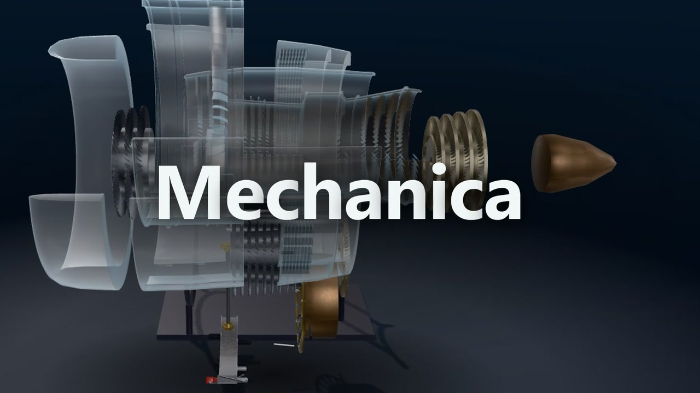
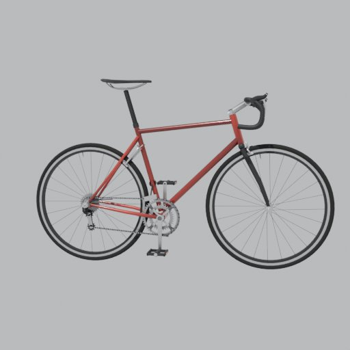
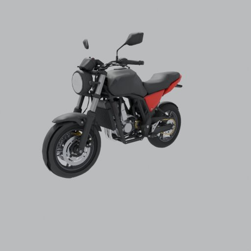
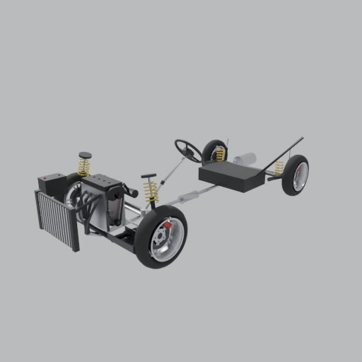
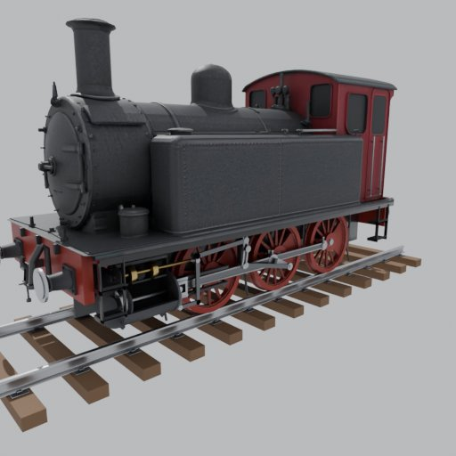
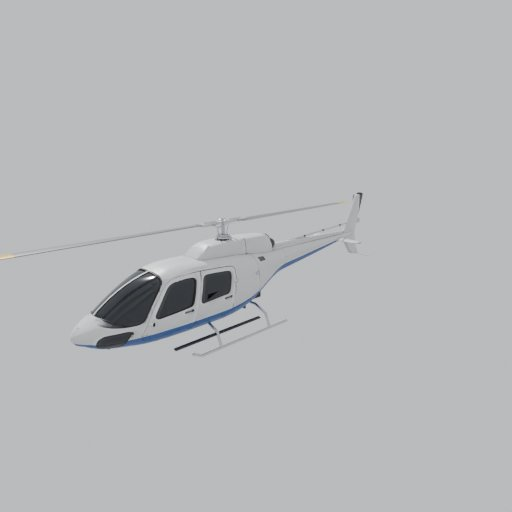
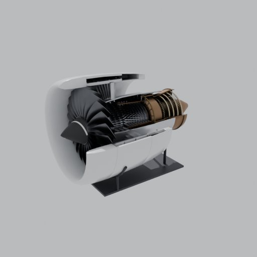
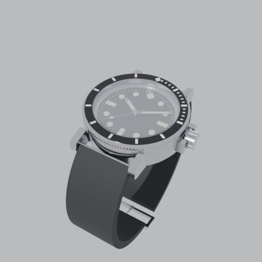
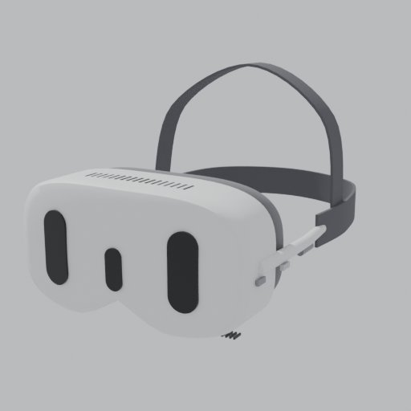
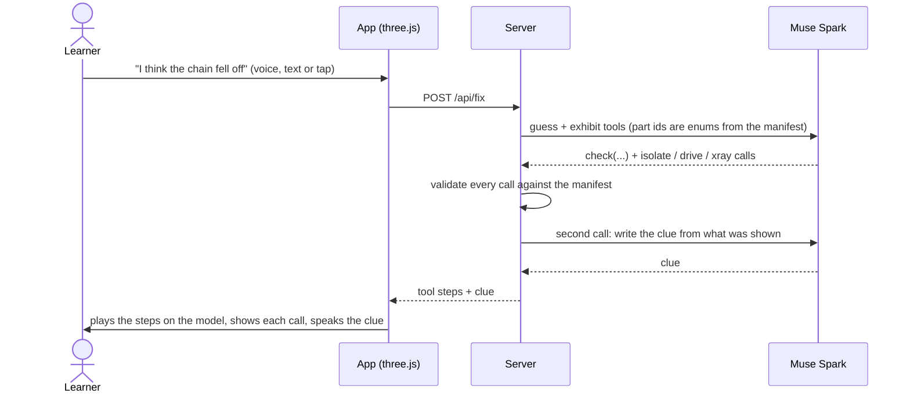

<div align="center">

<a href="https://youtu.be/Ata6pzX-ook"></a>

# Mechanica

**An interactive machine classroom where Meta Muse Spark is the teacher.**

Pick a machine, find what's broken, take it apart, ask why. Muse Spark answers by moving the real parts of the 3D model.

[](https://mechanica.hoson.xyz)
[](https://youtu.be/Ata6pzX-ook)
[](LICENSE)

Muse Spark · SAM 3.1 · Muse Voice Transcribe · WebXR on Meta Quest

<sub>Meta Global AI Developer Hackathon · Indie track · by Jim (<code>jhuang-tw</code>)</sub>

</div>

---

> [!NOTE]
> **Everything in this repository was built during the hackathon.** The repository was created on 2026-10-27, and the work started on 2026-10-26. Each feature, the Meta model it uses and its commits are listed in [`docs/BUILT_DURING_HACKATHON.md`](docs/BUILT_DURING_HACKATHON.md). An earlier private prototype was used only as a design reference. None of its code, models or media are here.

## Eight machines, 282 moving parts

All eight were modelled from scratch during the hackathon. Open any of them in a phone browser, or tap **VR** on a Meta Quest.

<table>
  <tr>
    <td align="center"><br><b>Road bicycle</b></td>
    <td align="center"><br><b>700 cc motorbike</b></td>
    <td align="center"><br><b>Car</b></td>
    <td align="center"><br><b>Steam locomotive</b></td>
  </tr>
  <tr>
    <td align="center"><br><b>Helicopter</b></td>
    <td align="center"><br><b>Turbofan jet</b></td>
    <td align="center"><br><b>Mechanical dive watch</b></td>
    <td align="center"><br><b>Mixed-reality headset</b></td>
  </tr>
</table>

The app is in English and Traditional Chinese.

## What it does

| | Feature | Meta model |
|---|---|---|
| 🔧 | **Repair challenge** (the home screen). A broken machine runs in front of you. Guess the fault by voice, typing or a tap. Muse Spark checks your guess on the 3D model with its tools (isolate, drive, X-ray) and gives a clue. Repair it, explain why in your own words, and Muse grades the explanation and replays the link you missed. Every tool call is shown on screen as it plays. | Muse Spark tool calling, Muse Voice Transcribe |
| 🎬 | **Muse tour** (讓 Muse 帶你看). One tap and Muse Spark directs a 30–60 s narrated teardown, calling a `scene` tool 3–8 times for camera moves, explode, X-ray, isolate and drives. | Muse Spark tool calling |
| 🩻 | **X-ray teardown.** Taking a machine apart turns its shell to glass, so the mechanism stays visible. Muse can call `xray` too. | Muse Spark tool calling |
| 📷 | **Photo to 3D.** Photograph a real machine. Muse Spark names it and its parts with boxes, SAM 3.1 traces each part on the photo, and a tapped trace flies into that part of the exploded 3D model. | Muse Spark vision, SAM 3.1 |
| 💬 | **Ask Muse.** Ask anything about the machine. The answer is a demonstration that Muse Spark choreographs with the exhibit's own controls. | Muse Spark tool calling, Muse Voice Transcribe |
| 🎓 | **Lessons, guess first, Muse tutor, explain it back.** 25 cause-and-effect lessons, a prediction before each step, and a Socratic tutor that grades free answers and remembers weak spots. | Muse Spark, Muse Voice Transcribe |
| ✋ | **Hands-on parts.** Drag a pedal or piston and the whole drive follows at real gear ratios. Doors and cowls swing on their hinges. Ride the motorbike and the car in first person. | — |
| 🥽 | **VR on Meta Quest.** The same URL in WebXR: wrist menu, real hand meshes, two fists to explode, turn and move, voice questions. | Muse Voice Transcribe |

## How a repair turn works



A turn takes about 4–6 seconds. Each exhibit is one JSON manifest (parts, real drives with gear ratios, linkages, lessons, faults), and that manifest is also the schema for Muse's tools. The model cannot name a part or move a value the machine doesn't have.

## How Meta's models are used

All model calls go through `server/meta.mjs`, and keys stay on the server.

- **Muse Spark** (`muse-spark-1.3`) with **tool calling.** The exhibit's whole action surface (`isolate`, `highlight`, `hide`, `show`, `detach`, `rotate`, `drive`, `xray`, plus the tour's `scene` tool for camera framing, orbit and explode) is exposed as tools, with part ids as enums from the exhibit manifest. The server and client check every call against the manifest (known parts only, clamped values) before it plays. It powers Ask Muse, the Muse tour, the tutor, explain-back and the repair challenge (`check` and `grade` tools).
- **Muse Spark vision** names the machine in a photo and returns each visible part with a box.
- **SAM 3.1** (`sam-3.1`, parsed with the official `@meta-sam/parser`) masks the parts Muse saw. The client keeps the mask instance that best matches Muse's box.
- **Muse Voice Transcribe** (`muse-voice-transcribe-1.0`) takes push-to-talk WAV from the phone or the headset, followed by one Muse Spark pass that fixes part names.
- Meta's **IWER** WebXR emulator is used in development to test the Quest mode without a headset.

Spoken lines use Inworld TTS-2 Flash (not a Meta model), with Azure or the browser's own voice as fallbacks.

## Run it

```bash
npm install
cp .env.example .env      # set META_API_KEY (INWORLD_API_KEY optional)
npm start                 # build + server → http://localhost:8098
npm run dev               # dev: Vite on 8099 (/api goes to 8098; also run node server/serve.mjs)
npm test                  # offline tests, no model calls
```

No headset? Run `npm run dev`, then open `http://localhost:8099/?xr` to emulate a Quest 3 with IWER.

<details>
<summary><b>VR controls</b></summary>

- **Menu:** open your left hand, palm facing you, and tap the gear on the inside of the wrist with your right index finger (controllers: Y or B). It switches exhibits, lessons, quiz, explode, reset, Muse tour, voice question and exit.
- **Pick a part:** trigger, or pinch along the ray. The part lights up and its explanation is read aloud.
- **Two fists** (controllers: both grips): pull apart to explode, twist to turn, push or lift together to move.
- **Subtitles:** one line below your view that fades after a few seconds. The full answer is spoken.

</details>

## Project layout

```
src/                  front end (Vite + three.js): landing, exhibit view, part rig, Muse playback, photo, VR
public/exhibits/      exhibits: index.json; <id>/manifest.json, model.glb, thumb.jpg
server/               Node server: static files + /api (Muse Spark, tools, vision, SAM 3.1, Voice Transcribe, TTS)
tools/                model build scripts (build123d CAD, Blender, GLB optimizer, content export/import)
docs/                 interfaces, hackathon ledger, submission text
test/                 node --test
```

| Document | What's in it |
|---|---|
| [`docs/BUILT_DURING_HACKATHON.md`](docs/BUILT_DURING_HACKATHON.md) | Every feature with its Meta model, commits and date; third-party packages; rights for every asset |
| [`docs/interfaces.md`](docs/interfaces.md) | The exhibit manifest contract and the `/api` endpoints |
| [`docs/SUBMISSION.md`](docs/SUBMISSION.md) | Submission text |
| [`docs/PITCH.md`](docs/PITCH.md) · [`docs/VIDEO.md`](docs/VIDEO.md) | Pitch and demo video notes |

To add or change a contract, edit `docs/interfaces.md` first, then make `npm test` pass. There are no brand logos, and only assets we have rights to (see the asset table in the ledger).

## License

MIT, see [`LICENSE`](LICENSE). Third-party packages and assets keep their own licenses (listed in the ledger).

---

## 中文簡介

**Mechanica 是手機打開就能玩的機械教學，老師是 Meta Muse Spark。**

- **修理挑戰**（首頁）：看一台壞掉的機器，說出你的猜測，Muse Spark 用工具在 3D 模型上檢查給你看。
- **Muse 導覽**、**X 光拆解**、**真機照片 → SAM 3.1 → 3D 零件**、**課程與先猜再看**、**Muse 家教**。
- 同一個網址在 Meta Quest 上可以進 VR。

所有程式、模型與資料都是活動期間（2026-10-26 起）做的，見 [`docs/BUILT_DURING_HACKATHON.md`](docs/BUILT_DURING_HACKATHON.md)。
